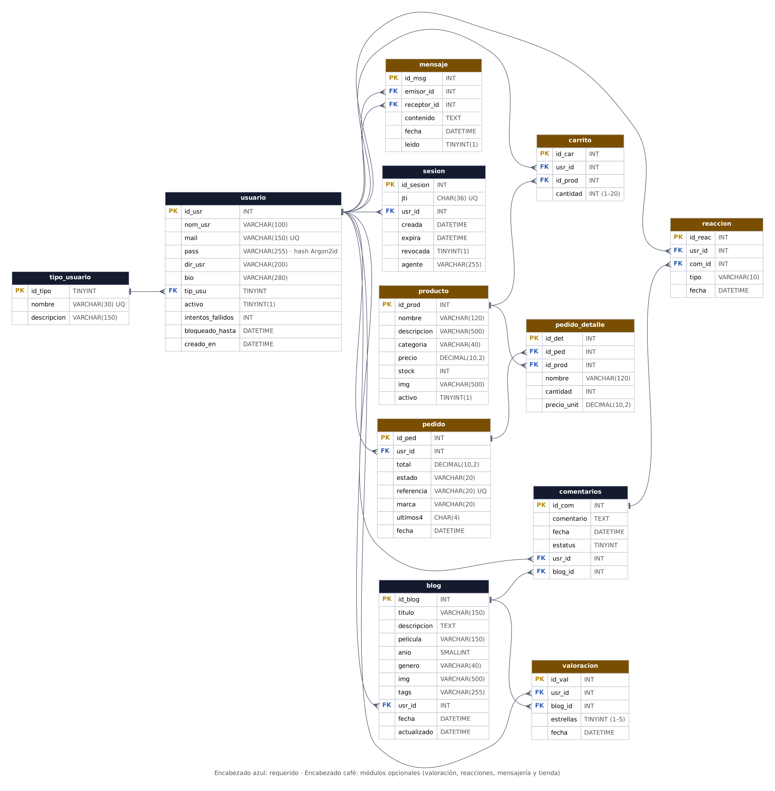
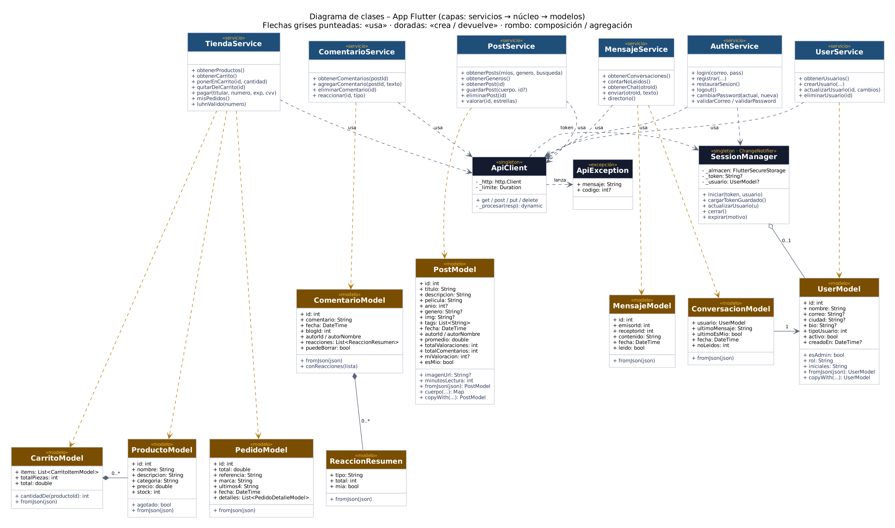

# Blog de reseñas de películas

Proyecto de la Evaluación Unidad 3 (Caso práctico: Diseño de blog).

Aplicación móvil hecha en Flutter que se conecta a una API en FastAPI con base de datos MySQL. Los usuarios se registran, inician sesión, publican reseñas de películas, comentan, califican con estrellas, reaccionan a los comentarios, se mandan mensajes y pueden comprar en la tienda del blog.

## Tecnologías

- App: Flutter 3.47 (Dart 3.13)
- API: FastAPI, SQLAlchemy, PyJWT, pwdlib (Argon2)
- Base de datos: MySQL 8

## Funcionalidades

Requeridas:

- Registro e inicio de sesión desde la app.
- Contraseñas guardadas con hash Argon2id.
- Sesiones con token JWT con expiración. Cada sesión se guarda en la tabla `sesion` y al cerrar sesión el token se revoca.
- Ver reseñas propias y de otros usuarios (filtro "Todas" / "Mis reseñas" y por género).
- Crear y leer comentarios en cada reseña.

Módulos opcionales:

- Tienda: catálogo de productos, carrito de compras y pago en línea simulado.
- Valoración con estrellas (1 a 5) en cada reseña.
- Reacciones con emoji en los comentarios.
- Mensajería privada entre usuarios.

Otros puntos de seguridad:

- La cuenta se bloquea 5 minutos después de 5 intentos fallidos.
- Roles de Administrador y Autor. Al registrarse siempre se crea como Autor.
- Solo el autor o el administrador pueden editar o borrar una reseña.
- En el pago solo se guardan la marca y los últimos 4 dígitos de la tarjeta.

## Estructura

```
blog-peliculas/
├── database/   script de la base de datos (blog_peliculas.sql)
├── api/        API en FastAPI
├── app/        aplicación Flutter
└── docs/       diagramas y reporte (Word y PDF)
```

## Cómo correrlo

Se necesita tener instalado MySQL 8, Python 3.11 o superior y Flutter.

### 1. Base de datos

Abrir `database/blog_peliculas.sql` en MySQL Workbench y ejecutarlo completo. Se crea la base `blog_peliculas` con datos de prueba.

Usuarios de prueba (contraseña `Peliculas2026`):

| Correo | Rol |
|---|---|
| admin@cine.test | Administrador |
| sofia@cine.test | Autor |
| carlos@cine.test | Autor |
| andrea@cine.test | Autor |

### 2. API

Dentro de la carpeta `api`:

```
python -m venv .venv
.venv\Scripts\activate
pip install -r requirements.txt
copy .env.example .env
```

En el archivo `.env` poner el puerto, usuario y contraseña de MySQL. Para `JWT_SECRET` generar una clave con:

```
python -c "import secrets; print(secrets.token_urlsafe(48))"
```

Levantar la API:

```
uvicorn app.main:app --reload --host 0.0.0.0 --port 8000
```

La documentación de los endpoints queda en http://127.0.0.1:8000/docs

Pruebas de la API: `python -m pytest -v`

### 3. App

Dentro de la carpeta `app`:

```
flutter pub get
flutter run -d chrome
```

- En el emulador de Android la app usa `http://10.0.2.2:8000` automáticamente.
- En un celular físico: `flutter run --dart-define=API_URL=http://IP_DE_LA_PC:8000` (la PC y el celular en la misma red).
- En Windows hay que activar el Modo de desarrollador (`start ms-settings:developers`) para que Flutter pueda usar los plugins.

Pago de prueba: tarjeta `4242 4242 4242 4242`, fecha `12/30`, CVV `123`. La tarjeta `4000 0000 0000 0002` siempre es rechazada.

## Endpoints principales

| Método | Ruta | Descripción |
|---|---|---|
| POST | /auth/registro | Registro |
| POST | /auth/login | Inicio de sesión |
| POST | /auth/logout | Cerrar sesión |
| GET | /posts | Lista de reseñas |
| POST | /posts | Crear reseña |
| PUT | /posts/{id}/valoracion | Calificar con estrellas |
| GET, POST | /posts/{id}/comentarios | Leer y escribir comentarios |
| POST | /comentarios/{id}/reacciones | Reaccionar a un comentario |
| GET, POST | /mensajes/{usuario_id} | Chat privado |
| GET | /productos | Catálogo |
| GET, PUT, DELETE | /carrito | Carrito de compras |
| POST | /pedidos/pagar | Pagar el carrito |
| GET | /usuarios | Gestión de usuarios (solo admin) |

## Diagramas

Modelo de datos:



Diagrama de clases de la app:


